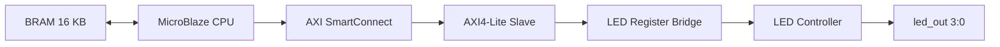

# MicroBlaze AXI4-Lite LED SoC

**Thiết kế và mô phỏng hệ thống SoC dùng CPU MicroBlaze điều khiển 4 LED qua giao tiếp AXI4-Lite trên FPGA.**

> **Trạng thái:** Đã có thiết kế RTL, Block Design và testbench trong dự án Vivado. Kết quả 4 trạng thái LED được trình bày trong tài liệu báo cáo/mô phỏng. Chưa xác nhận chạy trên bo FPGA thật.

## 1. Tổng quan

Dự án triển khai một **MicroBlaze soft processor** trong vùng logic lập trình được (PL) của FPGA Zynq-7000. CPU truy cập ngoại vi LED theo mô hình **memory-mapped I/O** qua **AXI SmartConnect** và **AXI4-Lite Slave**.



Phần mềm C (khi được biên dịch thành ELF và liên kết với thiết kế) điều khiển thanh ghi LED; các khối RTL thực hiện giải mã thanh ghi và xuất tín hiệu LED.

## 2. Thành phần và công cụ

| Thành phần | Vai trò |
|---|---|
| **MicroBlaze** | CPU mềm thực thi chương trình |
| **Local BRAM (16 KB)** | Bộ nhớ lệnh và dữ liệu, giao tiếp ILMB/DLMB |
| **AXI SmartConnect** | Định tuyến giao dịch AXI |
| **AXI4-Lite Slave** | Giao tiếp thanh ghi theo AXI4-Lite |
| **`led_reg_bridge.v`** | Giải mã địa chỉ và lưu thanh ghi điều khiển |
| **`led_controller.v`** | Điều khiển 4 bit LED, hỗ trợ `enable` / `blink_mode` |
| **Clock Wizard / Processor System Reset** | Cung cấp clock và reset |

- **FPGA part:** `xc7z020clg484-1` (Zynq-7000, thiết kế sử dụng PL, không sử dụng ARM PS).
- **Công cụ:** AMD/Xilinx Vivado; Vitis được dùng trong quy trình biên dịch firmware MicroBlaze.
- **Clock thiết kế:** 100 MHz (chu kỳ 10 ns).
- **Mô phỏng:** Vivado XSim.

## 3. Sơ đồ địa chỉ (Memory Map)

| Địa chỉ | Thanh ghi | Chức năng |
|---|---|---|
| `0x44A00000` | `LED_DATA` | Dữ liệu điều khiển LED ở bit `[3:0]` |
| `0x44A00004` | `LED_CTRL` | Bit 0: `enable`; bit 1: `blink_mode` |

- **BRAM:** `0x00000000` – `0x00003FFF` (16 KB).
- **Vùng địa chỉ AXI Slave:** `0x44A00000` – `0x44A0FFFF` (64 KB được ánh xạ; không có nghĩa là có 64 KB thanh ghi).

**Ví dụ điều khiển:** ghi `LED_DATA = 0x05`, sau đó `LED_CTRL = 0x01` → `led_out[3:0] = 0101` (LED3 tắt, LED2 sáng, LED1 tắt, LED0 sáng).

## 4. Cấu trúc tệp nguồn chính

```text
soc/
├── soc.xpr
└── soc.srcs/
    ├── sources_1/
    │   ├── bd/Microblaze_Controller/Microblaze_Controller.bd
    │   └── new/
    │       ├── led_reg_bridge.v
    │       └── led_controller.v
    ├── sim_1/new/
    │   └── tb_microblaze_led_system.v
    └── constrs_1/new/
        └── main.xdc
```

File RAR dự án gốc còn có các thư mục do Vivado tạo như `soc.gen/`, `soc.cache/`, `soc.runs/` và `soc.sim/`. Thông thường không cần đưa các dữ liệu sinh tự động này vào Git.

## 5. Mô phỏng và kết quả mong đợi

Testbench `tb_microblaze_led_system.v` cấp clock, reset và quan sát đầu ra LED. Chuỗi trạng thái được dùng để kiểm tra:

| Test case | Kết quả LED mong đợi |
|---|---|
| TC1 | `0101` |
| TC2 | `1010` |
| TC3 | `0000` (tắt bằng `enable = 0`) |
| TC4 | `1111` |

Báo cáo mô phỏng của dự án ghi nhận **4/4 test cases PASS**. Đây là kết quả **mô phỏng**, không phải xác nhận đã chạy trên phần cứng thật.

### Mở dự án

1. Mở **Vivado**, chọn **Open Project** và trỏ đến `soc/soc.xpr`.
2. Mở **Block Design** `Microblaze_Controller`, kiểm tra các IP và kết nối clock/reset.
3. Nếu Vivado báo thiếu IP, kiểm tra và thêm lại **IP Repository** của AXI4-Lite Slave.
4. Để tái tạo bài thử chạy firmware trên MicroBlaze, cần có **chương trình C và file ELF phù hợp**, rồi associate ELF với MicroBlaze trong Vivado trước khi chạy **XSim**.
5. Chạy testbench `tb_microblaze_led_system` và quan sát `led_out[3:0]` cùng các tín hiệu AXI.

**Lưu ý về khả năng tái tạo:** Gói RAR được cung cấp có RTL, Block Design và testbench nhưng **chưa thấy `main.c` của ứng dụng LED hoặc `microblaze_led_test.elf`**. Một ELF bootloop do Vivado sinh tự động không thay thế firmware điều khiển LED. Vì vậy, chỉ riêng repository này có thể **chưa đủ** để tái chạy toàn bộ bài thử end-to-end như trong báo cáo.

## 6. Giới hạn và hướng phát triển

- Xác minh thêm các kênh **AXI read (AR/R)**, tình huống AW/W đến khác chu kỳ và ghi từng byte qua `WSTRB`.
- Kiểm tra chi tiết chế độ **blink** và timing.
- Bổ sung firmware `main.c`, file cấu hình Vitis và hướng dẫn build ELF.
- Triển khai trên bo FPGA thật, bổ sung ràng buộc chân và kiểm tra timing.

## 7. Nguồn tham khảo và ghi nhận

- **AXI4-Lite Slave**: mã nguồn mở từ [suoglu/AXI-lite-slave](https://github.com/suoglu/AXI-lite-slave). Khi công bố lại mã nguồn/IP bên thứ ba, cần giữ nguyên các thông báo bản quyền và điều kiện giấy phép đi kèm (nếu có).
- **AXI4 / AXI4-Lite**: tài liệu AMBA AXI của Arm.
- **MicroBlaze, Vivado, Vitis**: tài liệu của AMD/Xilinx.

---

*Dự án phục vụ học tập và nghiên cứu thiết kế SoC/FPGA.*
